<p align="center">
  
</p>

<p align="center">
  
  
  
</p>
<p align="center">
  
  
  
  
  
  
</p>

<p align="center">
  <a href="#see-it-work">See it work</a> ·
  <a href="#how-it-works">How it works</a> ·
  <a href="#inside-the-agent">Inside the agent</a> ·
  <a href="#results">Results</a> ·
  <a href="#run-it">Run it</a> ·
  <a href="#whats-next-the-agent-picks-up-the-wrench">What's next</a> ·
  <a href="#the-crew">The crew</a>
</p>

---

It is 02:40 on night shift. Coolant pump **P-101** has started to lose suction. Nothing on the panel is red: discharge pressure has dropped a little and flow is slightly down, both still well inside their alarm limits. The fixed-threshold alarm will not fire for another day, and when it does, it will say *what* tripped but not *why*.

**Operion** notices 40 minutes after the drift begins. An AI agent running on the **AMD Radeon API** reads the sensor trends, the maintenance history, the pump manual and the spare-parts stock, and concludes *cavitation, about 7 hours to failure*. It shows its evidence, and the backend checks every reference against plant data before anyone is paged. The alert reaches the engineer on shift with the first safety step (lock out the pump). The supervisor then gets a 5-year repair-versus-replace comparison that pays back in 20 months.

> One workflow, done well: **detect early → explain with evidence → alert the right person → decide repair or replace.**

**Who it is for:** maintenance technicians on shift, who need plain steps, and the maintenance supervisor, who needs severity, time to failure and cost. The setting is a mid-size manufacturing plant.

---

## See it work

Every screenshot below comes from a live run against the AMD endpoint, with no mocks: a cavitation fault injected into P-101 on the simulated plant.

<table>
  <tr>
    <td width="50%">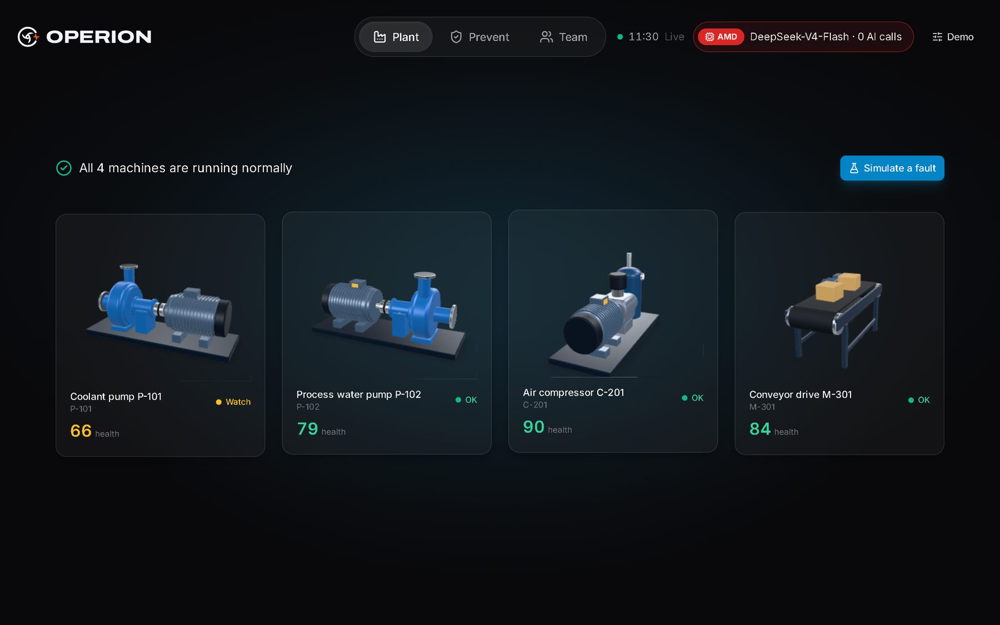</td>
    <td width="50%">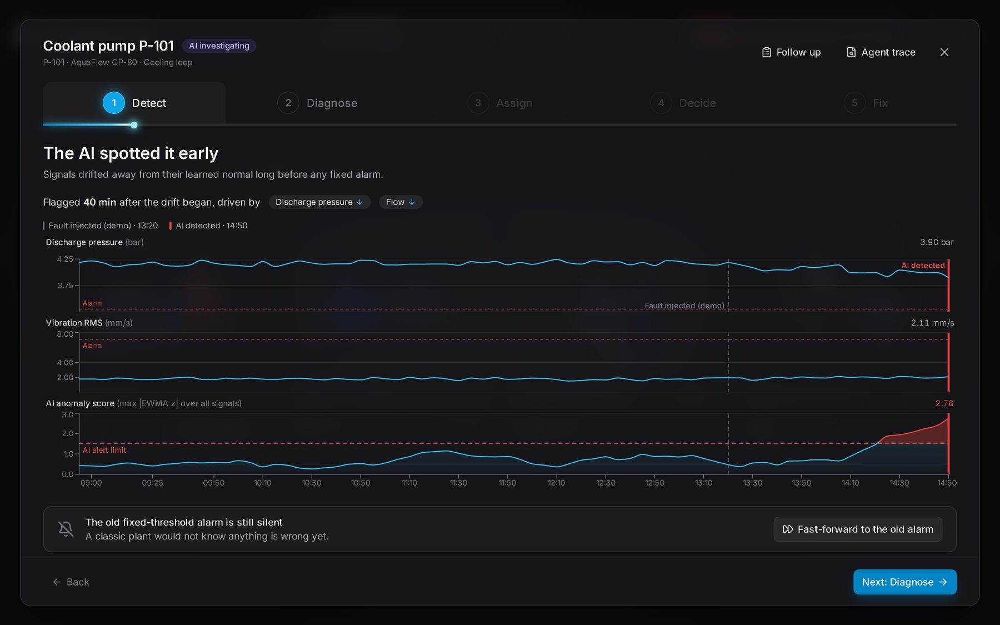</td>
  </tr>
  <tr>
    <td><b>1 · The plant.</b> Four machines in 3D, live health scores, and the AMD inference chip in the header.</td>
    <td><b>2 · Detect.</b> Flagged 40 min after the drift began, driven by discharge pressure and flow. <i>"The old fixed-threshold alarm is still silent."</i></td>
  </tr>
  <tr>
    <td>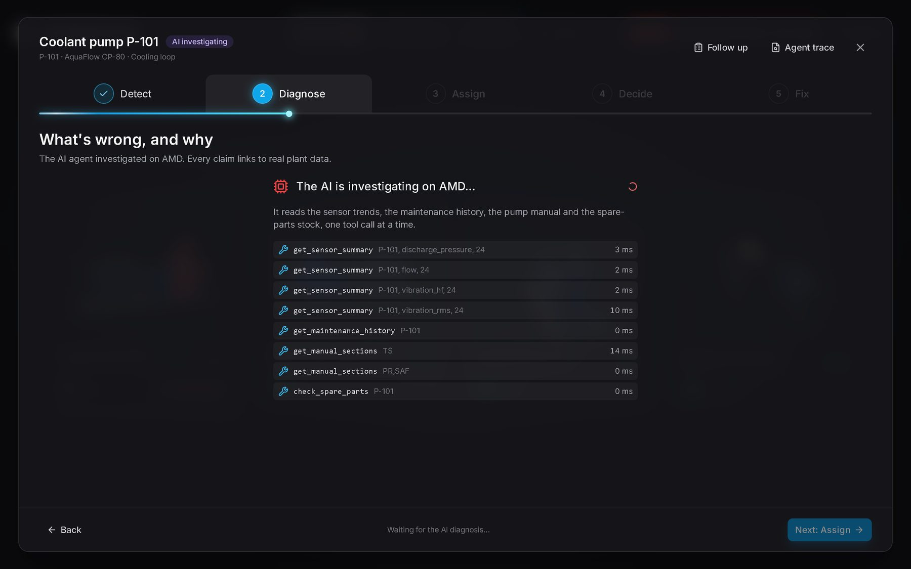</td>
    <td>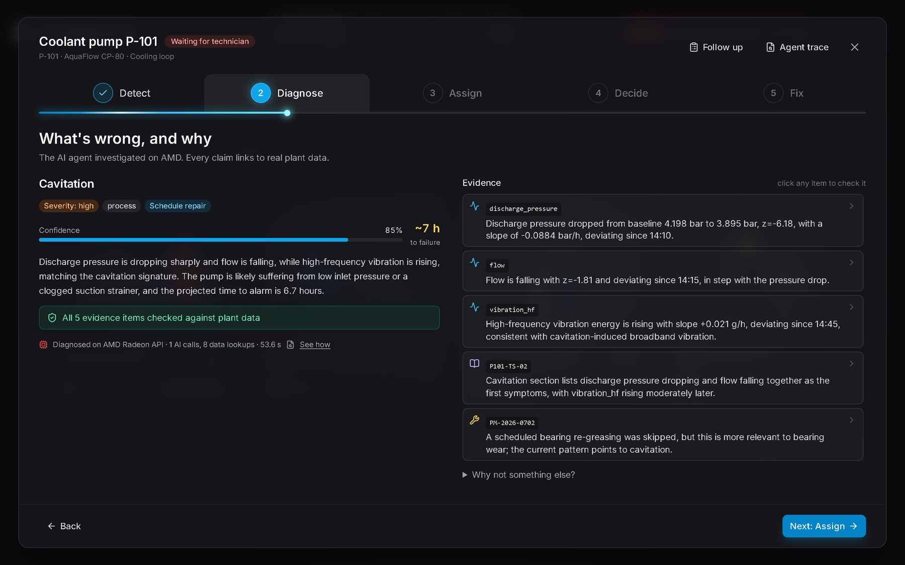</td>
  </tr>
  <tr>
    <td><b>3 · Investigate on AMD.</b> Each lookup appears live: sensors, history, manual sections, spare parts.</td>
    <td><b>4 · Diagnose.</b> Cavitation, 85% confident, ~7 h to failure. <i>"All 5 evidence items checked against plant data."</i> Each one opens its source.</td>
  </tr>
  <tr>
    <td>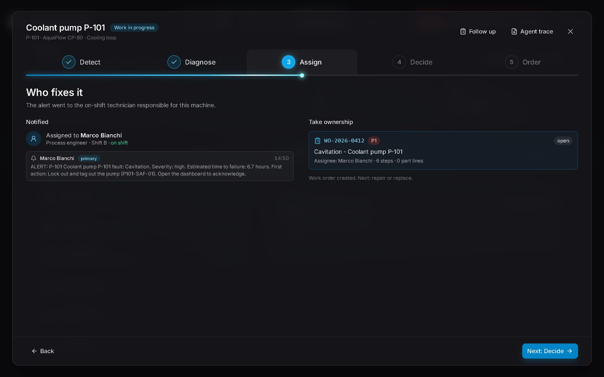</td>
    <td>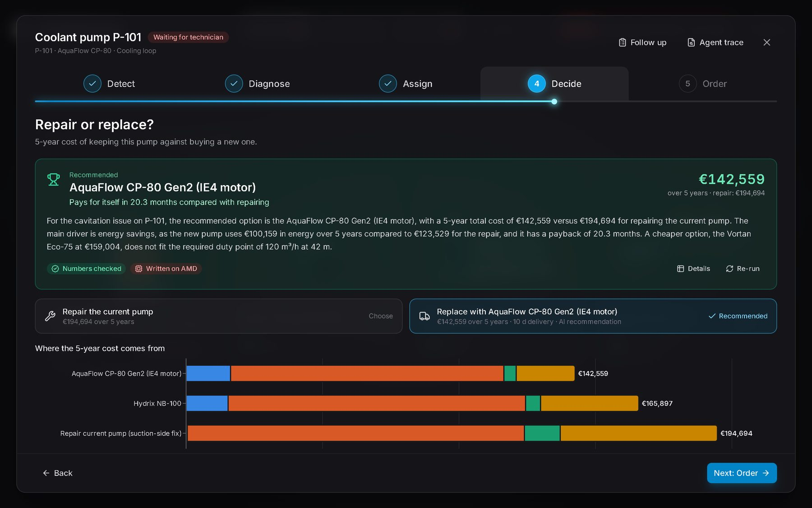</td>
  </tr>
  <tr>
    <td><b>5 · Assign.</b> Cavitation is a process fault, so it goes to the process engineer on shift. One click creates <code>WO-2026-0412</code>.</td>
    <td><b>6 · Decide.</b> €142,559 to replace vs €194,694 to keep repairing over 5 years. The AI wrote the rationale and code checked every number in it.</td>
  </tr>
</table>

<p align="center">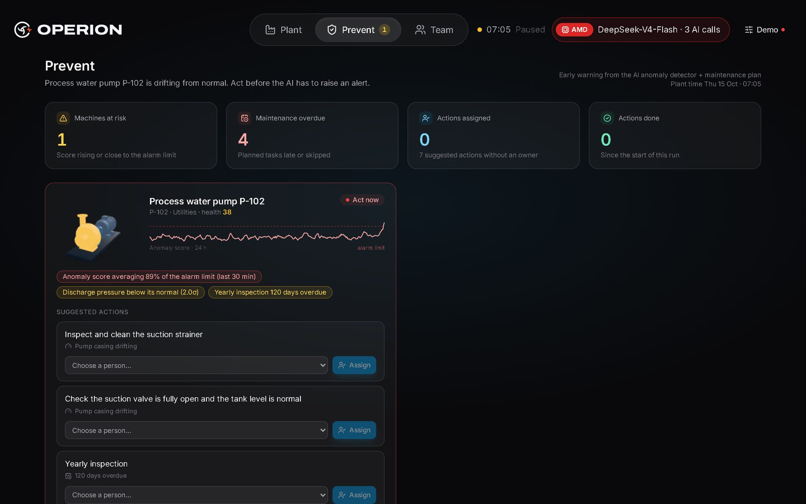</p>
<p align="center"><b>Better still: prevent it.</b> On a second pump, the <i>Prevent</i> page raises an early warning before any alert: the anomaly score averages 89% of its limit, the yearly inspection is 120 days overdue, and targeted actions are ready to assign.</p>

---

## How it works

<p align="center">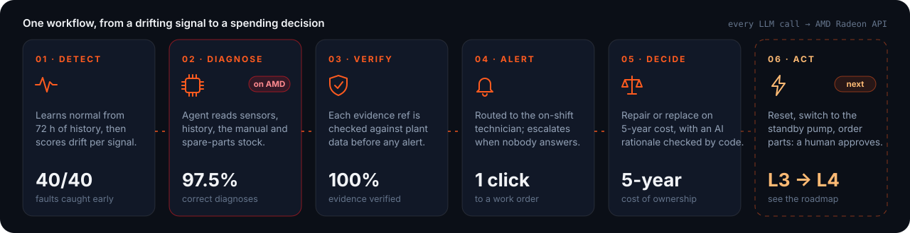</p>

| Stage | What happens | Where |
|---|---|---|
| **Detect** | Each signal's healthy baseline is learned from 72 h of history, with the effect of plant load regressed out. Residuals become a robust z-score (median / MAD) and are smoothed with an EWMA. An event fires when the score stays above the limit for 6 samples in a row (30 simulated minutes). No black box: you can read every number. | `backend/app/detect/` |
| **Diagnose** | An agent on the AMD Radeon API names the fault, gives a confidence, alternatives, severity, time to failure, fix steps and parts. In `prefetch` mode (default) the backend gathers the evidence and makes **one** model call. In `tools` mode the model drives a native tool-calling loop. | `backend/app/agent/` |
| **Verify** | Every evidence reference must point at a real signal, maintenance record, manual section or part, *and* at something the agent actually retrieved. Bad refs go back to the model for a retry. Stock levels always come from inventory, never from the model. | `agent/validate.py` |
| **Alert** | Routed by fault category, plant area and shift to the right on-shift person. The supervisor is copied when the fault is critical. Unacknowledged after 120 min, it escalates. Telegram push is optional. | `backend/app/alerts/` |
| **Decide** | Repair vs. 3 catalog pumps on 5-year cost of ownership (purchase, energy, maintenance, downtime), checked against the duty point (120 m³/h at 42 m). The AI writes a 3-sentence rationale, and any number in it that is not in the table is rejected. | `backend/app/decide/` |

**The rule behind all of it:** the numbers come from a transparent detector and plain formulas, and the reasoning comes from the agent on AMD. Every claim is backed by evidence anyone can check.

---

## Inside the agent

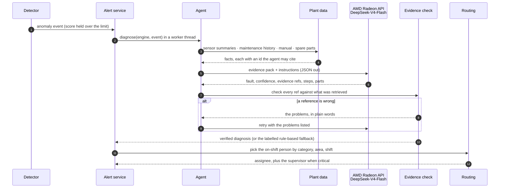

**Built not to lie:**

- **`diagnose()` never raises.** On an API error, in mock mode, or on anything unexpected, a rule-based fallback answers, and the UI says so. A fallback answer is never presented as the model's reasoning.
- **Evidence or it didn't happen.** A reference the agent never retrieved is rejected, even if it exists.
- **Numbers are checked by code.** The repair-vs-replace rationale may only use numbers from the cost table. If it invents one twice, a template sentence replaces it.
- **Every call is on the record.** Model, latency, tokens and purpose go to `llm_calls.jsonl` and to `GET /api/amd/stats`, which feeds the AMD panel in the UI.
- **People decide.** The agent recommends. Acknowledging, rejecting, resolving and buying are buttons that belong to people.

<details>
<summary><b>The four tools the agent can use</b></summary>

| Tool | Returns |
|---|---|
| `get_sensor_summary(machine_id, signal, hours)` | Stats and trend of one signal against its learned baseline and alarm limits |
| `get_maintenance_history(machine_id, limit)` | Machine facts, age, records newest first, corrective repairs in the last 12 months |
| `search_manual(query, k)` | Best-matching manual sections (BM25) with their section ids |
| `check_spare_parts(machine_id, keyword)` | Parts that fit this machine, with stock, location and lead time |

Tools never raise. A problem comes back as `{"error": ...}` plus a hint, such as the list of valid signal names, so the model can recover by itself.

Try the agent without the UI:

```bash
python -m backend.app.agent.diagnose --fault bearing_wear --seed 7
```
</details>

---

## Architecture

<p align="center">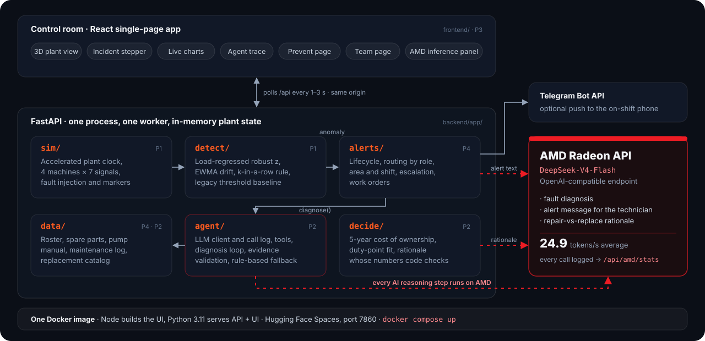</p>

One process, one worker, in-memory state. The engine steps every 100 ms. An anomaly opens an alert, and a worker thread runs *diagnose → validate → route → notify*. The UI polls every 1–3 s. The React app is built into the same Docker image, so one URL serves both the UI and the API.

<details>
<summary><b>API endpoints</b></summary>

| Method | Path | What it does |
|---|---|---|
| `GET` | `/api/plant` | All machines, health, status, active alerts |
| `GET` | `/api/machines/{id}/series` | Signal history, anomaly score, markers |
| `POST` | `/api/demo/inject` · `/control` · `/reset` | Inject a fault, change speed or pause, reset with a seed |
| `GET` | `/api/alerts` · `/api/alerts/{id}` | Alerts with diagnosis, trace, routing, work order |
| `POST` | `/api/alerts/{id}/ack` · `/resolve` | Take ownership (creates a work order), close it |
| `POST` | `/api/machines/{id}/replace-analysis` | 5-year repair-vs-replace comparison |
| `GET` | `/api/people` · `/api/manual/{section}` · `/api/maintenance/{id}` | Roster, manual sections, maintenance log |
| `GET` | `/api/amd/stats` | Every LLM call: model, latency, tokens/s, errors |

Interactive docs at `/docs` once the app runs.
</details>

---

## The stack, as a P&ID

A maintenance tool should be drawn the way plants are drawn. Here is our stack as a **Process & Instrumentation Diagram**: data flows through pipes, libraries are equipment, and the bubbles show live readings.

<p align="center">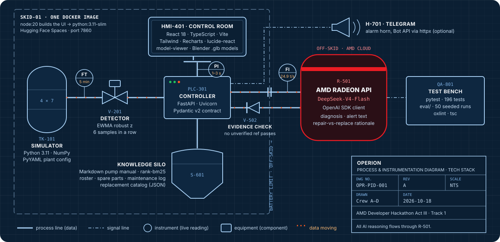</p>

<details>
<summary><b>Bill of materials</b></summary>

| Tag | Component | Job in the plant |
|---|---|---|
| `TK‑101` | Python 3.11 · NumPy · PyYAML | Simulated plant: 4 machines × 7 signals, 4 fault physics, accelerated clock |
| `V‑201` | NumPy | Detector: load regression, robust z-score, EWMA, k-in-a-row rule |
| `PLC‑301` | FastAPI · Uvicorn · Pydantic v2 | The API contract, in-memory state, serves the UI |
| `R‑501` | AMD Radeon API · DeepSeek-V4-Flash · `openai` SDK | Every piece of AI reasoning |
| `V‑502` | Python | Evidence check: no unverified reference reaches a person |
| `S‑601` | rank-bm25 · Markdown · JSON | Pump manual search, roster, spare parts, maintenance log, catalog |
| `HMI‑401` | React 18 · TypeScript · Vite · Tailwind · Recharts · lucide-react · model-viewer | The control room, with Blender-made `.glb` machines |
| `H‑701` | Telegram Bot API · httpx | Optional push to the on-shift phone |
| `SKID‑01` | Docker · Hugging Face Spaces | One image, port 7860 |
| `QA‑801` | pytest · oxlint · `eval/` | 196 tests, 50 seeded evaluation runs |
</details>

---

## The fault gallery

The agent knows four failure modes of a centrifugal pump. Each one leaves its own fingerprint in the signals, and the 3D model glows where the agent says the problem is.

| 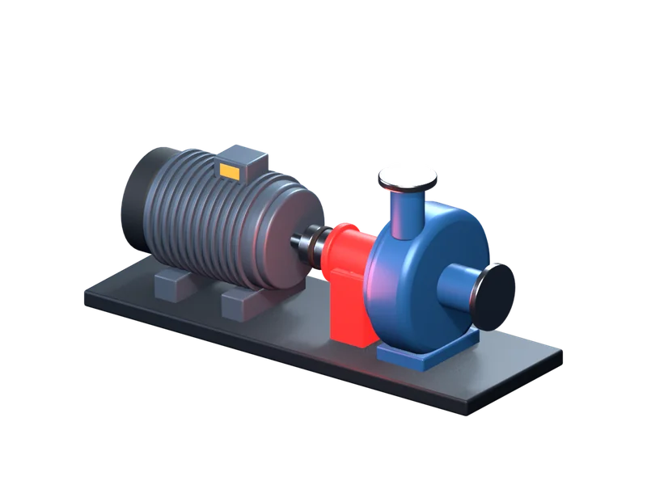 | 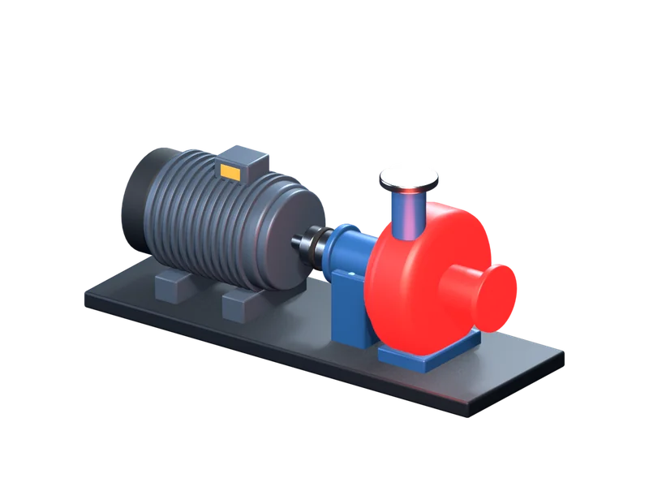 | 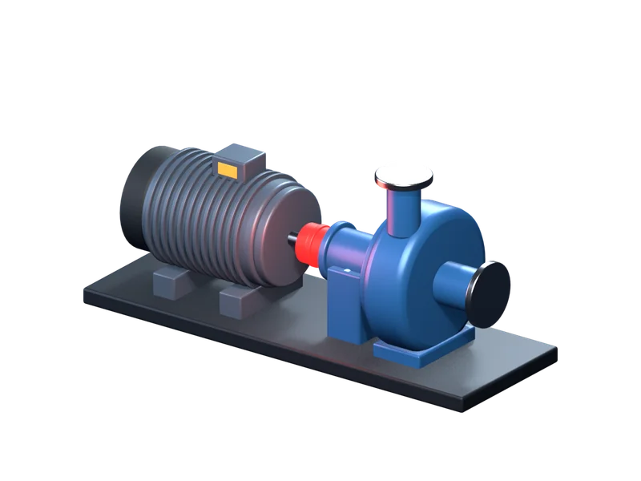 | 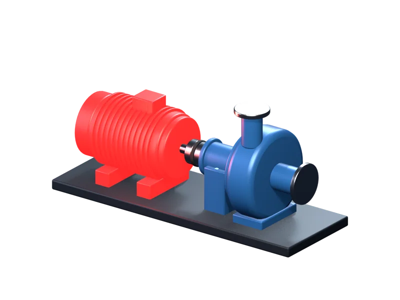 |
|:---:|:---:|:---:|:---:|
| **Bearing wear** | **Cavitation** | **Misalignment** | **Motor overheating** |
| HF vibration ↑ first, then bearing temp, RMS | Discharge pressure ↓ and flow ↓, noisy vibration | RMS ↑, bearing and motor temp ↑, current ↑ | Winding temp ↑↑, current ↑ |
| Manual `P101-TS-01` | Manual `P101-TS-02` | Manual `P101-TS-03` | Manual `P101-TS-04` |
| Ends in: bearing seized | Ends in: pump lost prime | Ends in: coupling failure | Ends in: motor trip |

---

## Results

<p align="center"></p>

Evaluated on a simulated plant: **40 fault runs** (4 fault types × 10, random severity, onset, duration and noise) and **10 healthy runs**, all with fixed seeds. Full report: [`eval/report.md`](eval/report.md).

| Metric | Result |
|---|---|
| Faults detected before the pump failed | **40/40** |
| Detection delay after fault onset (median) | **3.6 h** |
| Warning before failure, Operion (median / min) | **36.4 h** / 16.0 h |
| Warning before failure, legacy alarm (median / min) | 6.2 h / 0.2 h |
| Runs where the legacy alarm never fired | 9/40 |
| False alarms on healthy runs | **0/10** (720 simulated hours) |
| Correct diagnoses | **39/40 (97.5%)**: bearing wear 10/10, cavitation 10/10, misalignment 9/10, motor overheating 10/10 |
| Diagnoses passing evidence verification | **100%**, 0 fallbacks |
| Latency per diagnosis on AMD (mean / median) | 31.5 s / 29.2 s, 1 model call, ~10k prompt tokens |
| Throughput on the AMD Radeon API | **24.9 tokens/s** average |

**Read these honestly.** All data is simulated, with fault signatures we designed ourselves. The evaluation covers one pump (P-101) and four fault types. The 97.5% came after a pipeline fix that we made after seeing results on these same scenarios, so treat it as optimistic. A fresh-seed rerun is on the roadmap.

**Check the AMD claim yourself:** run a diagnosis, then open the AMD chip in the header or call `GET /api/amd/stats`. You will see the provider, model, endpoint, every call with its purpose, latency and tokens/s, and the error count.

---

## Run it

**Fastest: Docker.** Without an API key the app still runs, in mock mode: a rule-based diagnosis replaces the AI.

```bash
git clone https://github.com/BelaidiYassinee/amd-hackathon-project.git
cd amd-hackathon-project
cp .env.example .env          # put your key in RADEON_API_KEY (Windows: copy)
docker compose up --build
```

Open <http://localhost:7860>, then **Demo → Simulate a fault → P-101 → Cavitation**. The diagnosis on AMD takes about 30–60 s.

<details>
<summary><b>Without Docker</b></summary>

```bash
python -m venv .venv
source .venv/bin/activate             # Windows: .venv\Scripts\activate
pip install -r backend/requirements.txt
cd frontend && npm ci && npm run build && cd ..
uvicorn backend.app.main:app --host 0.0.0.0 --port 7860 --workers 1
```

For UI work, run `uvicorn backend.app.main:app --reload --port 8000` and `npm run dev` in `frontend/` (Vite proxies `/api`). `npm run dev:mock` runs the UI on fixtures, with no backend at all.

Keep **one worker**: all plant state lives in memory.
</details>

<details>
<summary><b>Tests and evaluation</b></summary>

```bash
python -m pytest                        # 196 tests
python -m eval.run_eval --no-llm        # detection only, no API calls
python -m eval.run_eval --limit 3       # detection + AI diagnosis on a small subset (uses the API)
python -m eval.run_eval                 # the full report in eval/report.md
```
</details>

<details>
<summary><b>Configuration</b> (<code>.env</code>, see <code>.env.example</code>)</summary>

| Variable | Default | What it does |
|---|---|---|
| `RADEON_API_KEY` | (empty) | Key for the AMD endpoint. Empty means mock mode |
| `LLM_BASE_URL` | `https://developer.amd.com.cn/radeon/api/v1` | OpenAI-compatible endpoint |
| `LLM_MODEL` | `DeepSeek-V4-Flash` | Model name |
| `LLM_TIMEOUT_S` | `60` | Per-call timeout |
| `LLM_MOCK` | `0` | `1` = no API calls, rule-based diagnosis |
| `AGENT_MODE` | `prefetch` | `prefetch` = one call with gathered evidence, `tools` = native tool loop |
| `LOG_DIR` | `backend/logs` | Where `llm_calls.jsonl` goes |
| `TELEGRAM_BOT_TOKEN` · `TELEGRAM_CHAT_IDS` | (empty) | Optional push alerts, `person_id:chat_id` pairs |
| `PORT` | `7860` | HTTP port |

Changing `LLM_BASE_URL` and `LLM_MODEL` is all it takes to point Operion at another OpenAI-compatible server, for example a vLLM instance on your own AMD Instinct GPU.
</details>

<details>
<summary><b>Repository layout</b></summary>

```
backend/
  app/
    sim/       accelerated plant: machines, fault physics, markers
    detect/    load-regressed robust z + EWMA detector, legacy threshold baseline
    agent/     LLM client, tools, prompts, diagnosis loop, evidence check, fallback
    alerts/    alert lifecycle, routing, escalation, notifications
    decide/    repair vs. replace: 5-year cost, duty-point fit, checked rationale
    api/       FastAPI routers (plant, alerts, decide)
  data/        machines.yaml, roster, spare parts, maintenance log, catalog, pump manual
  tests/       196 tests
frontend/      React + Vite + TypeScript dashboard, 3D models in public/models/
eval/          scenarios, detection and diagnosis evaluation, report.md
assets/        Blender renders of the machines
docs/team/     the API contract and the four build briefs we worked from
Dockerfile     one image: Node builds the UI, Python serves API + UI
```
</details>

---

## What's next: the agent picks up the wrench

Today Operion **recommends**. The next step is to let it **act**, one rung at a time, with a person approving every action and every action reversible.

<p align="center">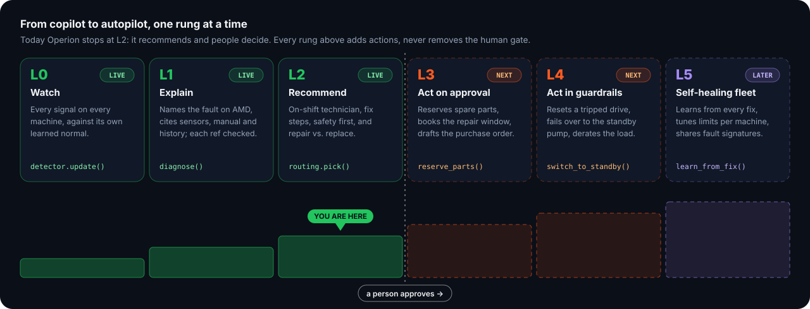</p>

### New tools, each with a guardrail

The agent gets **action tools** next to its read-only ones. Each declares who must approve it, what must be true before it runs, how success is verified on the sensors, and how to undo it.

```yaml
# proposed: backend/app/agent/actions.yaml
- name: reserve_parts            # L3
  approve: technician
  undo: release_reservation

- name: schedule_repair          # L3: book the next low-load window
  approve: supervisor
  undo: cancel_slot

- name: draft_purchase_order     # L3: the replacement from the decide step
  approve: supervisor
  undo: void_draft

- name: restart_machine          # L4: reset a tripped drive
  approve: supervisor
  pre:    [no_active_lockout, trip_cause_cleared, max_1_restart_per_30_min]
  verify: signals_normal_for_15_min
  undo:   controlled_stop

- name: switch_to_standby        # L4: P-101 → P-102 failover
  approve: supervisor
  pre:    [standby_healthy, standby_not_in_maintenance]
  verify: flow_and_pressure_restored
  undo:   switch_back

- name: derate_load              # L4: slow the wear until the repair window
  approve: supervisor
  pre:    [max_derate_20_percent]
  verify: anomaly_score_falling
  undo:   restore_setpoint
```

### Example: resetting a tripped pump

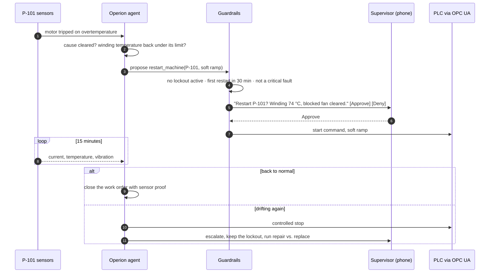

### Also on the list

- **Real plant data.** OPC UA and MQTT connectors, public bearing datasets, and a fresh-seed evaluation on unseen scenarios.
- **Learn from every fix.** Technicians' resolutions are already logged. Feed them back so the agent remembers that *this* pump's "bearing wear" was really misalignment last time.
- **On-premise AI on AMD Instinct.** The same OpenAI-compatible client, pointed at vLLM on an MI300X in the plant, so sensor data never leaves the site.
- **Radio mode.** The technician holds a button and asks *"what's wrong with P-101?"*, and the agent answers in the calm, short voice we designed for it in [`backend/agent.md`](backend/agent.md).
- **AR fault glow.** Point a phone at the pump and the part the agent blames lights up, using the same Blender fault zones as the dashboard ([`frontend/scripts/blender/fault_zones.py`](frontend/scripts/blender/fault_zones.py)).
- **Incident replay.** Scrub through an incident like a video (signals, agent trace, decisions) to train new technicians on real cases.
- **Shift handover digest.** At every shift change, five lines per machine for the incoming crew: what drifted, what was done, what to watch.
- **More machines.** The compressor and conveyor are already in the plant. Next come their fault physics, manuals and replacement catalogs.

---

## The crew

Four people, four lanes, one binding API contract ([`docs/team/00-project-and-contract.md`](docs/team/00-project-and-contract.md)). Each of us owned our own files and merged at fixed checkpoints, and the whole thing was built in one week.

<p align="center">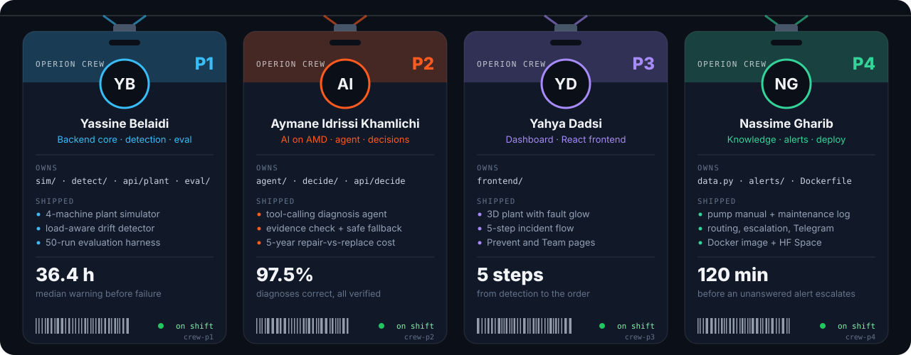</p>

---

<sub>**Data note.** The plant, its sensor data and its faults are simulated. Every brand, pump model, supplier and person in the seed data (AquaFlow, Vortan, Hydrix, the roster) is fictional. No text was copied from real manuals. Built for the AMD Developer Hackathon Act III (lablab.ai), Track 1: Intelligent Industry. All AI inference runs on the AMD Radeon API.</sub>
